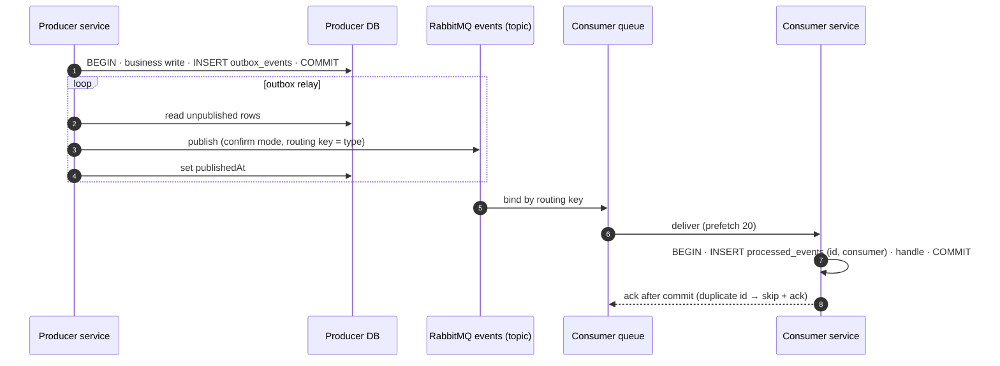

# Event Contracts

_Last updated: 2026-11-11._ Events carry **facts** between services over RabbitMQ. Inside a service,
modules call each other's services directly; jobs inside a service use BullMQ.

**Status:** the contracts and the envelope are defined in code. The outbox relay, publisher,
consumers and inbox are not built yet (Phase 2), so **nothing is published today**.

| Code                                                                                                          | What                                                                    |
| ------------------------------------------------------------------------------------------------------------- | ----------------------------------------------------------------------- |
| [`packages/infra/src/events/envelope.ts`](../packages/infra/src/events/envelope.ts)                           | `EventEnvelope<Type, Data>`, `EVENT_TYPE_PATTERN`                       |
| [`packages/infra/src/events/contracts/auth.events.ts`](../packages/infra/src/events/contracts/auth.events.ts) | auth-service contracts (`AUTH_EVENTS`, payload types, `AuthEventMap`)   |
| `services/*/prisma/schema/outbox.prisma`                                                                      | `outbox_events` (producer side) and `processed_events` (consumer inbox) |

## Envelope

```ts
interface EventEnvelope<TType, TData> {
  id: string; // UUID v7 = outbox row id = inbox de-dup key
  type: TType; // routing key, e.g. "user.registered.v1"
  version: number; // the N in .vN
  occurredAt: string; // ISO-8601, producer commit time
  source: string; // "auth-service"
  correlationId: string; // originating request id, carried through every hop
  causationId?: string; // event that caused this one
  data: TData;
}
```

## Delivery



- **At-least-once.** The producer may publish an event twice, and the consumer inbox makes
  handling idempotent.
- **Failures.** Implemented today (`@farmx/infra/rabbitmq`): a failed delivery is re-queued with an
  `x-farmx-attempts` header, up to 5 attempts, then dead-lettered to `<queue>.dlq` (bound on
  `events.dlx`). A malformed envelope goes straight to the DLQ. Delayed retry queues (`.5s`, `.30s`,
  `.5m`) are a later refinement. The relay retries an outbox row up to 10 times (`attempts`, `lastError`).
- **Ordering** is not guaranteed across events. Consumers use `occurredAt` and the current state,
  never the arrival order.
- **Names.**
  - Exchange: `events` (topic). Retry exchange: `events.retry`. Dead-letter exchange: `events.dlx`.
  - Routing key: `<aggregate>.<event>.v<N>`.
  - Consumer queue: `<consumer-service>.<purpose>`, for example `notification.auth-events`.

## Rules

1. **The producer owns the contract.** It lives in `@farmx/infra/events/contracts/<producer>.events.ts`.
   Consumers import the types and never import producer code.
2. **Published contracts are never edited.** A breaking change becomes a new `.v(N+1)` type. Publish
   both versions until every consumer has moved, then retire the old one. Adding an optional field
   is the only non-breaking change.
3. **No secrets.** Never put passwords, hashes, OTP codes, tokens or keys in an event.
4. **Minimal personal data.** Include personal data only when a consumer needs it to act. Consumers
   must handle `user.deleted.v1` by deleting or anonymising their copy (DPDP).
5. **Facts, not commands.** Events are named in the past tense. To ask another service to do
   something, use internal HTTP.

## Catalog

### Published by auth-service

| Type                          | When                                                                                        | Payload (`data`)                                                                                                                      |
| ----------------------------- | ------------------------------------------------------------------------------------------- | ------------------------------------------------------------------------------------------------------------------------------------- |
| `user.registered.v1`          | A user account is created by any channel                                                    | `userId`, `userType`, `fullName`, `email \| null`, `phone \| null`, `preferredLanguage`, `registrationSource`, `parentUserId \| null` |
| `user.status_changed.v1`      | Activation, suspension, deactivation, lock, deletion request / cancel (`PENDING_DELETION`)  | `userId`, `previousStatus`, `status`, `changedByUserId \| null`                                                                       |
| `user.deleted.v1`             | Admin soft delete, or self-service purge after the grace period (D-55)                      | `userId`, `deletedByUserId \| null`                                                                                                   |
| `auth.session_compromised.v1` | Refresh-token reuse detected; the session family was revoked                                | `userId`, `familyId`, `revokedSessions`, `ip \| null`, `deviceId \| null`                                                             |
| `user.profile_updated.v1`     | Customer self-service: `PATCH /me` (name, email, photo) or a verified mobile change (D-58b) | `userId`, `userType`, `fullName`, `phone \| null`, `email \| null`, `changedFields[]` (current values, not a diff)                    |

`user.profile_updated.v1` consumer: farm-service queue `farm-service.events` (D-58b) syncs
`farm_owners.fullName` (never with a blank name) and `phone`, then drops the farm caches after commit.

Other consumers: none yet. The notification service will add welcome / account / security rules once they are (docs/notifications). Other expected consumers:
and services that keep a local read model of users.

### Published by farm-service

Contracts: [`contracts/farm.events.ts`](../packages/infra/src/events/contracts/farm.events.ts).
Rows are written to `outbox_events` in the same transaction (relay pending, Phase 2).

| Type                        | When                                   | Payload (`data`)                                                                                                                                                                                                                                                                                            |
| --------------------------- | -------------------------------------- | ----------------------------------------------------------------------------------------------------------------------------------------------------------------------------------------------------------------------------------------------------------------------------------------------------------- |
| `farm.submitted.v1`         | Registration submitted or resubmitted  | `farmId`, `ownerId`, `category`, `channel`                                                                                                                                                                                                                                                                  |
| `farm.activated.v1`         | Farm ID issued                         | `farmId`, `farmCode`, `ownerId`, `ownerUserId`, `category`, `productionTypes`, `territoryCode`, `pinCode`, `totalBirdCapacity`                                                                                                                                                                              |
| `farm.review_required.v1`   | Duplicate case opened                  | `farmId`, `caseId`, `signals`, `slaDueAt`                                                                                                                                                                                                                                                                   |
| `farm.needs_attention.v1`   | Changes requested from the owner       | `farmId`, `ownerUserId`, `issues[{docType, code}]`                                                                                                                                                                                                                                                          |
| `farm.status_changed.v1`    | Any status transition                  | `farmId`, `from`, `to`, `actorType`                                                                                                                                                                                                                                                                         |
| `farm.updated.v1`           | Capacity, address or admin correction  | `farmId`, `changedFields`                                                                                                                                                                                                                                                                                   |
| `farm.merged.v1`            | Duplicate merged into an existing farm | `farmId`, `intoFarmId`                                                                                                                                                                                                                                                                                      |
| `farm.owner_kyc_changed.v1` | Owner KYC status moved                 | `ownerId`, `ownerUserId`, `kycStatus`                                                                                                                                                                                                                                                                       |
| `farm.facts_changed.v1`     | After EVERY write to the farm row      | `FarmFactsV1`: `farmId`, `farmCode`, `ownerUserId`, `name`, `category`, `productionTypes`, `gstin`, `gstVerified`, `gstBusinessName`, `gstTradeName`, `invoiceName`, `gstVerifiedAt` (B2B / ITC billing), `stateCode` (GSTIN prefix, else territory state), `territoryCode`, `pinCode`, `status`, `version` |

`farm.facts_changed.v1` is a full snapshot (the farm row `version` after the write), so a read model never has to call farm-service back. Consumer: order-service.

**Content events** (feature `content`, D-50). No coordinates, farm ids or reader ids; readers are
resolved by the consumer through `GET /internal/farms/content/:id/audience?scope=segment|savers|both`
(keyset pages of user ids). Every payload carries `contentId`, `contentVersion`, `kind`, `severity`,
`title`, `placeLabel`.

| Event                  | When                                               | Extra payload                | Consumer audience                     |
| ---------------------- | -------------------------------------------------- | ---------------------------- | ------------------------------------- |
| `content.published.v1` | An item goes live with `notify` (ALERT default)    | `summary`                    | target segment                        |
| `content.corrected.v1` | An approved correction is applied with `notify`    | `correctionNote`             | segment + savers                      |
| `content.retracted.v1` | A live / ended item is withdrawn as wrong (always) | `retractNote`, `wasNotified` | savers (+ segment when `wasNotified`) |

Expected consumers: notification (pass, review and attention messages), loyalty, order, pricing
(tonnage tiers from capacity). The `user.deleted.v1` consumer in farm-service is pending (Phase 2).

### Published by catalog-service

| Type                          | When                                                           | Data                                                     |
| ----------------------------- | -------------------------------------------------------------- | -------------------------------------------------------- |
| `catalog.brand_updated.v1`    | Brand name, code, slug or active flag changed                  | `brandId`, `name`, `code`, `slug`, `isActive`, `version` |
| `catalog.brand_deleted.v1`    | Brand soft-deleted (after the product-service reference block) | `brandId`                                                |
| `catalog.category_deleted.v1` | Category soft-deleted (after the reference block)              | `categoryId`                                             |

Consumer: product-service, on queue `product-service.events`. It updates the brand name snapshot and the search text.

### Published by product-service

| Type                                            | When                                                       | Data                                                                                                                                                                                                                                       |
| ----------------------------------------------- | ---------------------------------------------------------- | ------------------------------------------------------------------------------------------------------------------------------------------------------------------------------------------------------------------------------------------ |
| `product.variant_created.v1`                    | Variant created (including with a new product)             | `VariantFactsV1`: ids, SKU, GTIN, names, manufacturer, pack, Rx, temperature class, shelf life, `categoryId`, `categoryPath` (root → self), `brandId`, `hsnCode`, `gstRate`, `weightGrams` (D-56), `minOrderQty`, `maxOrderQty`, `version` |
| `product.variant_updated.v1`                    | Variant or stock-relevant product fact changed             | `VariantFactsV1`                                                                                                                                                                                                                           |
| `product.variant_deactivated.v1`                | Variant deactivated or deleted, or product deleted         | `variantId`, `productId`, `version`                                                                                                                                                                                                        |
| `product.published.v1` / `product.suspended.v1` | Product became sellable / stopped being sellable           | `productId`, `variantIds`, `reason`                                                                                                                                                                                                        |
| `product.review_moderated.v1`                   | A review changed status by moderation (admin or auto-hide) | `reviewId`, `productId`, `userId`, `status`, `action` (approve / reject / hide / restore / auto_hide), `reason` → notification to the author (D-49)                                                                                        |
| `product.rating_changed.v1`                     | Published rating totals of a product changed               | `productId`, `ratingAvg` (decimal string or null), `ratingCount`, `sequence` (epoch ms) → search, wishlist cards                                                                                                                           |

Consumers: inventory-service (inventory items), logistics master sync (FR-PRD-001), order-service (variant read model). A product category or brand change re-emits `variant_updated` for every variant with the same variant `version`, so consumers order snapshots by (`version`, `occurredAt`).

### Published by inventory-service (built 2026-11-21, D-33 / D-36)

| Type                                 | When                                                                                                                              | Data                                                                                                                                                        |
| ------------------------------------ | --------------------------------------------------------------------------------------------------------------------------------- | ----------------------------------------------------------------------------------------------------------------------------------------------------------- |
| `inventory.availability_changed.v1`  | Network sellable quantity of a variant changed (publisher job, 2 s; deduplicated: only on a real change, incl. a per-node change) | `variantId`, `availableQty`, `inStock`, `lowStock`, `byNode?` (`[{ nodeId, availableQty, inStock }]`, full allocatable set, D-52), `sequence` (per variant) |
| `inventory.low_stock.v1`             | A warehouse × variant **crossed down** to its reorder level (once per dip)                                                        | `variantId`, `warehouseId`, `availableQty`, `threshold`                                                                                                     |
| `inventory.reservation_committed.v1` | `order.paid` accepted (re-sent on a duplicate)                                                                                    | `reservationId`, `orderRef`, `recovered`, `lines[{warehouseId, variantId, qty}]` (D-56: what is held per warehouse)                                         |
| `inventory.reservation_rejected.v1`  | Late payment after expiry and the stock is gone (or nothing is held)                                                              | `reservationId`, `orderRef`, `shortfall[]`                                                                                                                  |
| `inventory.reservation_released.v1`  | Stock given back (reject / cancel / fail / admin / orphan sweep)                                                                  | `reservationId`, `orderRef`, `scope` FULL·PARTIAL, `lines[{warehouseId, variantId, qty}]` (per warehouse since D-56)                                        |
| `inventory.reservation_expired.v1`   | An ACTIVE (unpaid) hold passed its window                                                                                         | `reservationId`, `orderRef`                                                                                                                                 |

### Published by payment-service (built 2026-11-22, D-37 / D-45)

Contracts: `packages/infra/src/events/contracts/payment.events.ts`. Money is integer **paise**; only masked instrument data.

| Type                          | When                                                                           | Data                                                                                                         |
| ----------------------------- | ------------------------------------------------------------------------------ | ------------------------------------------------------------------------------------------------------------ |
| `payment.captured.v1`         | Money captured (once per payment; also for a closed order → order refunds, R5) | `paymentId`, `orderId`, `orderNo`, `amountPaise`, `expectedPaise`, `currency`, `method`, `providerPaymentId` |
| `payment.failed.v1`           | An attempt failed (retry allowed until expiry)                                 | `paymentId`, `orderId`, `errorCode`, `errorReason`                                                           |
| `payment.expired.v1`          | Not paid before `expiresAt` (after a live gateway check)                       | `paymentId`, `orderId`                                                                                       |
| `payment.refund_initiated.v1` | Gateway accepted the refund                                                    | `refundId`, `sourceRef`, `paymentId`, `orderId`, `amountPaise`, `providerRefundId`, `expectedBy`             |
| `payment.refund_processed.v1` | Refund completed (re-sent if the same `sourceRef` is requested again)          | … + `arn`, `refundedPaise`, `capturedPaise`                                                                  |
| `payment.refund_failed.v1`    | Retries exhausted / refused (EXCEEDS_CAPTURED, PAYMENT_NOT_CAPTURED …)         | `refundId`, `sourceRef`, `paymentId`, `orderId`, `amountPaise`, `reason`                                     |

Built in W2 (2026-11-21, D-54) — wallet top-ups only (purpose WALLET_TOPUP; never sent as the order events above):

| Type                        | When                                                              | Data                                                                                                                                                                                           |
| --------------------------- | ----------------------------------------------------------------- | ---------------------------------------------------------------------------------------------------------------------------------------------------------------------------------------------- |
| `payment.topup_captured.v1` | Money for a top-up captured (once per payment, also after expiry) | `paymentId`, `paymentNo`, `topupId`, `userId`, `amountPaise` (captured), `expectedPaise`, `currency`, `method`, masked `bank` / `cardLast4` / `cardNetwork` / `vpaMasked`, `providerPaymentId` |
| `payment.topup_failed.v1`   | A top-up attempt failed (retry allowed)                           | `paymentId`, `topupId`, `userId`, `errorCode`, `errorReason`                                                                                                                                   |
| `payment.topup_expired.v1`  | Not paid in time (after a live check)                             | `paymentId`, `topupId`, `userId`                                                                                                                                                               |

Wallet checkout (W3, D-54): a WALLET payment (order paid in full from the wallet) publishes the same `payment.captured.v1` / `payment.failed.v1` / `payment.expired.v1` with `method: "wallet"` (failure `errorCode` `INSUFFICIENT_WALLET_BALANCE` / `WALLET_FROZEN`); its refunds publish `payment.refund_*` with `arn` = wallet journal number.

### Consumed by payment-service

Queue `payment-service.events`: `order.refund_requested.v1` → refund (unique `sourceRef`; FAILED_FINAL + same sourceRef = retry); `order.rejected.v1` / `order.cancelled.v1` / `order.failed.v1` (scope FULL) → void the open payment.

### Consumed by inventory-service

Queue `inventory-service.events`: `product.variant_created.v1` / `variant_updated.v1` / `variant_deactivated.v1` → `inventory_variant_projections` (version-guarded, incl. temperature class for cold-chain allocation); `order.paid.v1` → commit (or recovery / reject); `order.rejected.v1` / `order.cancelled.v1` / `order.failed.v1` → release (FULL or PARTIAL lines). Order contracts live in `packages/infra/src/events/contracts/order.events.ts` ahead of their producer (OMS P3).

### Consumed by product-service

| Type                                | Producer                                             | Data                                                                                                                                                            |
| ----------------------------------- | ---------------------------------------------------- | --------------------------------------------------------------------------------------------------------------------------------------------------------------- |
| `inventory.availability_changed.v1` | inventory-service                                    | `variantId`, `availableQty`, `inStock`, `lowStock`, `sequence`                                                                                                  |
| `pricing.price_changed.v1`          | pricing-service (future)                             | `variantId`, `sellingPrice`, `currency`, `effectiveFrom`, `sequence`                                                                                            |
| `order.delivered.v1`                | F1 shipments (future; contract in `order.events.ts`) | `orderId`, `orderNo`, `userId`, `deliveredAt`, `lines[{ lineNo, variantId, productId, qty }]`, `netPaidPaise` (D-54: reward points) → review eligibility (D-49) |

A projection applies an event only if its `sequence` is newer than the stored one.

### Published by order-service (orders, built 2026-11-23, D-34…D-45)

Contracts: `packages/infra/src/events/contracts/order.events.ts`. Ids only, never PII.

| Type                        | When                                                                                                                                   | Data                                                                                                                                  |
| --------------------------- | -------------------------------------------------------------------------------------------------------------------------------------- | ------------------------------------------------------------------------------------------------------------------------------------- |
| `order.placed.v1`           | Order created (PENDING_ADMIN_CONFIRMATION, unpaid)                                                                                     | `orderId`, `orderNo`, `userId`, `farmId`, `grandTotal`, `paymentDueAt`, `shipTo {name, district, pinCode}` (D-56; no phone or street) |
| `order.paid.v1`             | Payment captured for an open order → inventory commits                                                                                 | `orderId`, `orderNo`, `reservationId` (null = look up by order), `paymentId`, `amount`                                                |
| `order.failed.v1`           | System closed it (unpaid / no stock / late payment, stock gone); also re-sent as ORDER_CLOSED when a commit arrives for a closed order | `orderId`, `orderNo`, `reservationId`, `scope` FULL, `lines`, `reasonCode`                                                            |
| `order.refund_requested.v1` | Refund decision (late payment R5, stock rejected R4, failed after payment)                                                             | `sourceRef`, `orderId`, `paymentId`, `amountPaise`, `reason`, `isSystem`, `requestedBy`                                               |

Built in P4 (2026-11-24):

| Type                      | When                                                                     | Data                                                                                          |
| ------------------------- | ------------------------------------------------------------------------ | --------------------------------------------------------------------------------------------- |
| `order.confirmed.v1`      | Admin confirmed (paid + committed) → future shipments / invoice          | `orderId`, `orderNo`, `reservationId`, `confirmedAt`, active `lines` (lineNo, variantId, qty) |
| `order.rejected.v1`       | Admin rejected, or auto-rejected (REVIEW_TIMEOUT)                        | release shape: `scope` FULL, `reasonCode`                                                     |
| `order.cancelled.v1`      | Buyer / staff cancelled — whole (FULL) or some items (PARTIAL + `lines`) | release shape                                                                                 |
| `order.review_overdue.v1` | A paid order waited longer than the review SLA (once per order)          | `orderId`, `orderNo`, `waitingMinutes`                                                        |

`recovery-watch` re-sends a release (`order.rejected/cancelled/failed`) or `order.refund_requested` that did not land (same keys; consumers are idempotent).

### Consumed by order-service

Queue `order-service.events`: `product.variant_created.v1`, `product.variant_updated.v1`, `product.variant_deactivated.v1`, `pricing.price_changed.v1`, `inventory.availability_changed.v1` (cart soft stock check, `sequence`-guarded), `farm.facts_changed.v1` → `order_variant_projections` and `order_farm_projections`. Facts land only when (`version`, `occurredAt`) is newer than the stored pair; prices only when `sequence` is newer. Variant facts without `categoryId` / `brandId` (an older producer) are ignored.

Queue `order-service.events` now also binds `payment.captured/failed/expired/refund_initiated/refund_processed/refund_failed.v1` and `inventory.reservation_committed/rejected/released.v1` → order lifecycle (row lock + status guards; duplicates and stale events are no-ops). `payment.captured.v1` and `payment.refund_processed.v1` also write the order money ledger first (D-47, idempotent per payment / refund).

### Planned: order management + payments (D-34…D-45, not built yet)

The full list is in [`oms/06-events.md`](oms/06-events.md). It covers:

- `order.placed`, `order.paid`, `order.confirmed`, `order.rejected`, `order.cancelled`, `order.failed`, `order.refund_requested`, `order.review_overdue`
- `payment.captured`, `payment.failed`, `payment.expired`, `payment.refund_initiated`, `payment.refund_processed`, `payment.refund_failed`
- `inventory.reservation_committed`, `inventory.reservation_rejected`, `inventory.reservation_released`

All are `.v1`. Logistics and WMS will consume `order.confirmed.v1` (not `order.paid`, unlike Logistics PRD §8.5). A delivery OTP never travels in an event.

### Published by wallet-service (W1 built 2026-11-20, D-54)

Contracts: `packages/infra/src/events/contracts/wallet.events.ts`. Ids and amounts only.

| Type                           | When                                                                   | Data                                                                                                                        |
| ------------------------------ | ---------------------------------------------------------------------- | --------------------------------------------------------------------------------------------------------------------------- |
| `wallet.transaction_posted.v1` | A journal moved a customer wallet (once per journal, same transaction) | `journalId`, `journalNo`, `userId`, `kind`, `category`, `direction`, `amountPaise`, `balanceAfterPaise`, `refType`, `refId` |
| `points.transaction_posted.v1` | A points journal changed a customer's points (W4)                      | `journalId`, `journalNo`, `userId`, `kind`, `deltaPts`, `availableAfter`, `pendingAfter`, `refType`, `refId`                |
| `points.expiring_soon.v1`      | A lot's points expire within the notice window (once per lot)          | `userId`, `points`, `expiresAt`                                                                                             |

### Consumed by wallet-service

Queue `wallet-service.events`: `order.delivered.v1` → reward points (PENDING, needs `netPaidPaise`), `payment.refund_processed.v1` → pro-rata points reversal (once per refund), `payment.topup_captured.v1` → credit the top-up once (ledger key `topup:<id>`), `payment.topup_failed.v1` → FAILED (retry allowed), `payment.topup_expired.v1` → EXPIRED (a later capture still completes it).

### Consumed by warehouse-service (built 2026-11-23, D-56 P3)

Queue `warehouse-service.events` → the order read model of each warehouse (W2.03 Active Orders,
the `HAS_OPEN_ORDERS` deactivation guard):

- `order.placed.v1` → order header (order no, ship-to name, district, PIN).
- `inventory.reservation_committed.v1` → one NEW row per warehouse in `lines` (first commit wins).
- `order.confirmed.v1` → ALLOCATED. Safe ordering: an order can be confirmed only once its stock is
  COMMITTED, which order-service learns from `reservation_committed`.
- `order.delivered.v1` → DELIVERED.
- `order.rejected.v1` / `order.cancelled.v1` / `order.failed.v1` with scope FULL, and
  `inventory.reservation_released.v1` FULL → CANCELLED.
- `inventory.reservation_released.v1` PARTIAL → units reduced per warehouse line; none left → CANCELLED.

Status only moves forward; terminal rows never change.

### Consumed by notification-service (built 2026-11-19, D-46)

Queue `notification-service.events` (consume-only; publishes nothing): `order.placed.v1` (also
records order → buyer in `notification_order_projections`), `order.confirmed.v1`,
`order.rejected.v1`, `order.failed.v1` (`ORDER_CLOSED` re-sends notify nobody),
`order.cancelled.v1`, `order.review_overdue.v1`, `payment.captured.v1`, `payment.failed.v1`,
`payment.refund_initiated.v1`, `payment.refund_processed.v1`, `payment.refund_failed.v1`,
`inventory.low_stock.v1`, and the five `support.*.v1` events (D-55). Business dedupe keys absorb recovery re-sends; buyer events need the
order projection (an event before its `order.placed` is retried, then dead-lettered). Rules,
audiences and channels: [`notifications/README.md`](notifications/README.md#consumed-events).

### Published by support-service (built 2026-11-23, D-55)

Ids, codes and states only — never message text or phone numbers. Outbox → `events` exchange.

| Type                               | When                                                                 | Payload (`data`)                                                                                         |
| ---------------------------------- | -------------------------------------------------------------------- | -------------------------------------------------------------------------------------------------------- |
| `support.ticket_created.v1`        | A ticket is raised (app or agent intake)                             | `ticketId`, `ticketNo`, `app`, `requesterId`, `topicCode`, `priority`, `team`, `channel`, `resolveDueAt` |
| `support.ticket_replied.v1`        | An agent posted a PUBLIC message (never internal notes)              | ticket ref + `messageId`, `seq`, `agentId`                                                               |
| `support.ticket_status_changed.v1` | Any status transition (incl. auto-close)                             | ticket ref + `from`, `to`, `actorId                                                                      | null`            |
| `support.ticket_escalated.v1`      | Escalation to another team / agent                                   | ticket ref + `team`, `level`, `assigneeId                                                                | null`, `actorId` |
| `support.sla_breached.v1`          | First-response or resolve deadline passed (once per ticket and kind) | ticket ref + `kind`, `priority`, `team`, `assigneeId                                                     | null`, `dueAt`   |

Ticket ref = `ticketId`, `ticketNo`, `app`, `requesterId`. Consumer: notification-service
(requester push for replies / resolution / escalation; desk alerts for URGENT / HIGH tickets and
SLA breaches).

| Type                                    | When                                                                  | Payload (`data`)                                                               |
| --------------------------------------- | --------------------------------------------------------------------- | ------------------------------------------------------------------------------ |
| `support.application_status_changed.v1` | Staff approved / rejected a dealer / partner application (2026-11-24) | `applicationId`, `applicationType`, `applicantUserId`, `from`, `to`, `actorId` |

No business name or review notes in the payload. Consumer: notification-service (push to the
applicant, templates `support.application_approved` / `support.application_rejected`).

### Consumed by support-service

Queue `support-service.events`: `user.deleted.v1` → delete the requester's private files, scrub
their text / phone / name, close their open tickets (agent loads released), close their sockets;
`user.status_changed.v1` (not ACTIVE) → close the user's live-chat sockets on every replica.

### Published by warehouse-service (built 2026-11-23, D-56 P1)

Contracts: `packages/infra/src/events/contracts/warehouse.events.ts`. Full snapshots, applied only
when newer than what the consumer holds (duplicates and out-of-order deliveries are harmless).

| Type                             | When                                               | Data                                                                                                                                                                                                             |
| -------------------------------- | -------------------------------------------------- | ---------------------------------------------------------------------------------------------------------------------------------------------------------------------------------------------------------------- |
| `warehouse.upserted.v1`          | Warehouse created, edited, status changed, deleted | `warehouseId`, `version`, code, name, type (MOTHER/DEPOT), status (SETUP/ACTIVE/LIMITED/INACTIVE), parent, address, district, state, PIN, lat/long, `temperatureClasses`, `isAllocatable`, `priority`, `deleted` |
| `warehouse.coverage_replaced.v1` | Service areas / PINs changed                       | `warehouseId`, `coverageVersion`, `entries[{pinCode, priority}]` (the complete set, ≤ 5,000)                                                                                                                     |

Consumers: inventory-service → `inventory_warehouses` / `inventory_warehouse_coverage` projection
(same ids; allocation unchanged).

### Published by warehouse-service (built 2026-11-24, D-57)

Contracts: `packages/infra/src/events/contracts/warehouse.events.ts` (+ `inventory.events.ts`,
`order.events.ts` for the two events other services publish for D-57).

| Event                                 | When                                                     | Data (key fields)                                                                                                                                                                                                              | Consumers                       |
| ------------------------------------- | -------------------------------------------------------- | ------------------------------------------------------------------------------------------------------------------------------------------------------------------------------------------------------------------------------ | ------------------------------- |
| `warehouse.stock_changed.v1`          | Any physical stock change in WMS                         | `movementId`, `warehouseId`, `kind`, `lines[{variantId, sellableDelta, damagedDelta}]` (idempotent by movementId)                                                                                                              | inventory                       |
| `warehouse.thresholds_changed.v1`     | Safety / reorder / target edited (WMS owns them)         | `warehouseId`, `variantId`, `safetyStock`, `reorderLevel`, `targetStock`, `version`                                                                                                                                            | inventory (projection)          |
| `warehouse.stock_cutover.v1`          | Cutover step (freeze / activate / rollback)              | mode, step, by                                                                                                                                                                                                                 | inventory, ops                  |
| `warehouse.job_failed.v1`             | A job failed or its heartbeat is stale                   | `job`, `error`, `at`                                                                                                                                                                                                           | notification (ops admins)       |
| `shipment.status_changed.v1`          | Every shipment transition                                | `shipmentId`, `shipmentNo`, `orderId`, `orderNo`, `warehouseId`, `from`, `to`, `at`, `orderShipments` snapshot (each entry has the shipment `version`; consumers keep the highest per shipment, D-57 2026-11-24). Never an OTP | order (F1 status), notification |
| `shipment.dispatched.v1`              | Gate-out (PACKED / READY → DISPATCHED)                   | `dispatchId` (dedupe key), `shipmentId`, `orderId`, `warehouseId`, `lines[{variantId, qty}]`                                                                                                                                   | inventory (issue once)          |
| `shipment.split_planned.v1`           | A split / backorder plan executed with a notice          | `orderId`, `orderNo`, `legs[{warehouseId, qty, plannedAt}]`, `backorders[{variantId, qty, promiseDate}]`                                                                                                                       | notification (buyer notice)     |
| `warehouse.routing_rules_replaced.v1` | Any routing rule / fallback / throttle change; cap watch | Full snapshot: `version` (consumer keeps the highest), live `rules[]`, `fallback` (+ `maxDistanceKm`), `throttles[{warehouseId, paused, maxOrdersPerDay, capReached}]`                                                         | inventory (checkout)            |

Also new for D-57: `inventory.issue_rejected.v1` (inventory → WMS: over-issue at dispatch →
ISSUE_MISMATCH exception) and `order.delivery_updated.v1` (order → WMS: `orderId`, `orderNo`,
`changes[]`, `pinCode`, `district`, `deliveryPromise`; no PII — WMS pulls the facts again and raises
ALLOCATION_ISSUE when the assigned node no longer serves the PIN).

warehouse-service consumes (queue `warehouse-service.events`): `order.placed|paid|confirmed|delivered|rejected|cancelled|failed|delivery_updated.v1`,
`inventory.reservation_committed|reservation_released|issue_rejected|availability_changed.v1`
(the last feeds the W3.13 storefront sync, newest `sequence` wins), `product.variant_created|updated|deactivated.v1`.

### Published by warehouse-service (built 2026-11-25, D-62 gate)

| Event                          | When                                                                            | Data (key fields)                                                                                                                                                                                                                                                                                                     | Consumers                               |
| ------------------------------ | ------------------------------------------------------------------------------- | --------------------------------------------------------------------------------------------------------------------------------------------------------------------------------------------------------------------------------------------------------------------------------------------------------------------- | --------------------------------------- |
| `gate_entry.status_changed.v1` | Every gate entry status change (gate-in … exit, block, hold, turn-away, cancel) | `gateEntryId`, `entryNo`, `shipmentId`, `shipmentNo`, `warehouseId`, `vendorId`, `restockRequestId`, `vehicleRegNo`, `status`, `previousStatus`, `outcome` (COMPLETED / REJECTED), `netKg`, `varianceKg`, `debitNoteRequired`, `noReceipt`, `at`. **No driver PII.** Correlation id `gate:<entry>:<status>:<version>` | Future: W6 receiving, analytics, alerts |

### Published by quality-service (built 2026-11-25, D-60)

Contracts: `packages/infra/src/events/contracts/quality.events.ts`. Ids, codes and verdicts only.

| Event                                 | When                                           | Data (key fields)                                                                                                                                             | Consumer     |
| ------------------------------------- | ---------------------------------------------- | ------------------------------------------------------------------------------------------------------------------------------------------------------------- | ------------ |
| `quality.spec_changed.v1`             | A SKU specification is saved (W16.09)          | `variantId`, `holdOnReceipt`, `releaseMode`, `isActive`, `version` (keep the highest)                                                                         | warehouse    |
| `quality.decision_requested.v1`       | RELEASE / QUARANTINE / RECALL decided (W16.07) | `decisionId`, `decisionNo`, `batchId`, `kind`, `stateVersion` (orders decisions), `actorUserId`, `reason`                                                     | warehouse    |
| `quality.decision_retry_requested.v1` | QA retries the failed warehouses of a decision | `decisionId`, `batchId`, `warehouseIds`, `actorUserId`                                                                                                        | warehouse    |
| `quality.batch_state_changed.v1`      | Decision, COA review or COA expiry             | `batchId`, `state`, `qualityBlocked`, `certificateStatus`, `coaRef`, `version`                                                                                | warehouse    |
| `quality.coa_published.v1`            | Independent COA approved                       | `coaId`, `coaNo`, `batchId`, `batchNo`, `productName`, `verdict`, `cnNos`, `watcherUserIds`                                                                   | notification |
| `quality.batch_recalled.v1`           | Recall (failed independent COA or QA recall)   | `decisionId`, `batchId`, `batchNo`, `productName`, `cnNos`, `buyers[{userId, orderId, orderNo}]` (later buyers get their own event, once per decision × user) | notification |

New warehouse-service events for D-60 (`warehouse.events.ts`): `warehouse.receipt_created.v1` (CN + batch lines with variant facts and initial status, written in the receipt transaction), `warehouse.shipment_batches.v1` (gate-out: `customerUserId`, `orderNo`, `lines[{variantId, batchId, qty}]`), `warehouse.quality_tasks_planned.v1` (`decisionId`, `warehouseIds`), `warehouse.quality_task_updated.v1` (`status` DONE / NO_STOCK / FAILED / SUPERSEDED, `qtyMoved`, `attempts`, `error`).

quality-service consumes (queue `quality-service.events`): `warehouse.receipt_created|shipment_batches|quality_tasks_planned|quality_task_updated.v1`. warehouse-service now also consumes `quality.spec_changed|batch_state_changed|decision_requested|decision_retry_requested.v1`; notification-service consumes `quality.coa_published|batch_recalled.v1`.

### Pending design

- **`user.password_reset_requested.v1`.** Plan 02 lists this event, but the OTP code must never
  travel in an event. The open decision is whether auth-service sends OTPs itself through an SMS
  provider, or calls the notification service over internal HTTP. Either way, no event carries the
  code.
- **Role or permission changes.** These stay inside auth-service for now. Other services get
  permissions from the access token, not from events.

## Adding an event

1. Add the type and payload interface to the producer's `contracts/<producer>.events.ts`, and
   extend its `*_EVENTS` and `*EventMap`.
2. Add a row to the catalog above.
3. Write the outbox row in the same transaction as the business change (Phase 2 helper).
4. Consumers: create a queue named `<service>.<purpose>`, bind it to the routing key, and handle
   the event idempotently using the inbox.
